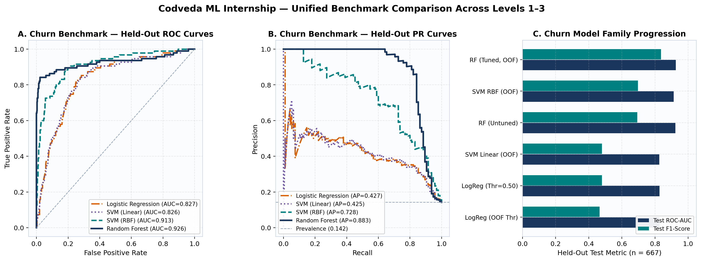

# Codveda Technologies — Machine Learning Internship Portfolio

[](#reproducibility--installation)
[](#technology-stack)
[](#automated-testing)
[](LICENSE)

End-to-end, reproducible machine-learning engineering portfolio fulfilling the **Codveda Technologies Machine Learning Internship** requirements (1 October 2026 – 1 November 2026) across **Level 1 (Basic)**, **Level 2 (Intermediate)**, and **Level 3 (Advanced)**.

Every pipeline transformation, cross-validation split, probability threshold, statistical confidence interval, figure, and test result in this repository was executed and verified against the official Codveda datasets with strict train/test separation and zero data leakage.

---

## Completed Tasks (2 Per Level — Official Requirement Verified)

| Portfolio ID | Official Level & Task | Dataset(s) | Core Engineering & Findings |
| :--- | :--- | :--- | :--- |
| **Task 1** | **Level 1 (Basic) — Task 1:** Data Preprocessing for ML | `2) Stock Prices Data Set.csv` ($497,472 \times 7$), `churn-bigml-80/20.csv`, `1) iris.csv` (+ full 6-dataset audit) | Chronological anti-leakage split; training-only median imputation + missingness indicators on 27 genuine `NaN` cells; unseen 2017 ticker handling; Churn billing VIF reduced from **`10,410,725.8` $\rightarrow$ `1.004`**. |
| **Task 2** | **Level 1 (Basic) — Task 3:** K-Nearest Neighbors Classifier | `1) iris.csv` ($120$ train / $30$ test, stratified) | 5-fold CV over $K \in \{1..31\}$, scaling & weighting; selected `K=3` (`CV Macro-F1 = 0.9665`, `Test Acc = 0.9333`, `ROC-AUC = 0.9933`); investigated scaling vs feature signal variance. |
| **Task 3** | **Level 2 (Intermediate) — Task 1:** Logistic Regression for Binary Classification | `churn-bigml-80.csv` ($2,666$) $\rightarrow$ `churn-bigml-20.csv` ($667$) | Preserved official 80/20 benchmark; 5-fold CV (`C=0.1, balanced`); leak-free OOF threshold calibration ($\tau^*=0.64$); 1,000-draw bootstrap 95% CIs on odds ratios (`Intl Plan OR = 7.28`); `Test ROC-AUC = 0.8274`. |
| **Task 4** | **Level 2 (Intermediate) — Task 2:** Decision Trees for Classification | `1) iris.csv` ($120$ train / $30$ test, stratified) | Minimal cost-complexity pruning (`ccp_alpha = 0.008114`) cut tree size from `8` leaves (`Depth=5`) to **`4` leaves (`Depth=3`)**, boosting held-out `Test Acc` from `0.9333` $\rightarrow$ **`0.9667`** (`Macro-F1 = 0.9666`). |
| **Task 5** | **Level 3 (Advanced) — Task 1:** Random Forest Classifier | `churn-bigml-80.csv` $\rightarrow$ `churn-bigml-20.csv` | 5-fold CV tuning (`300` trees, `max_depth=16`, OOF $\tau^*=0.44`); **Test Acc = `0.9565`, Precision = `0.9024`, Recall = `0.7789`, F1 = `0.8362`, ROC-AUC = `0.9258`, PR-AUC = `0.8828`**; MDI vs 30-repeat permutation importance + 10-seed stability (`AUC = 0.9268 ± 0.0021`). |
| **Task 6** | **Level 3 (Advanced) — Task 2:** Support Vector Machine (SVM) | `churn-bigml-80.csv` $\rightarrow$ `churn-bigml-20.csv` | Scaled inside `Pipeline`; RBF kernel outperformed Linear kernel (`Test ROC-AUC: 0.9130 vs 0.8258`, `Test F1: 0.6970 vs 0.4800`); 2D decision boundaries & 67D $\rightarrow$ 2D PCA projection critique (`17.8%` variance). |

---

## Summary of Held-Out Benchmark Results

Full machine-generated table: [`reports/model_comparison.csv`](reports/model_comparison.csv)

### Customer Churn Held-Out Test Split (`churn-bigml-20.csv`, $n = 667$, $14.24\%$ positive)

| Model | Threshold | Accuracy | Precision | Recall | F1-Score | ROC-AUC | PR-AUC |
| :--- | :---: | ---: | ---: | ---: | ---: | ---: | ---: |
| `DummyClassifier` (Most Frequent) | 0.50 | 0.8576 | 0.0000 | 0.0000 | 0.0000 | 0.5000 | 0.1424 |
| Logistic Regression (Default) | 0.50 | 0.7661 | 0.3512 | 0.7579 | 0.4800 | 0.8274 | 0.4271 |
| Logistic Regression (OOF-Calibrated) | 0.64 | 0.8246 | 0.4113 | 0.5368 | 0.4658 | 0.8274 | 0.4271 |
| SVM — Linear Kernel (OOF-Calibrated) | 0.24 | 0.8246 | 0.4154 | 0.5684 | 0.4800 | 0.8258 | 0.4246 |
| **SVM — RBF Kernel (OOF-Calibrated)** | **0.32** | **0.9100** | **0.6699** | **0.7263** | **0.6970** | **0.9130** | **0.7284** |
| Random Forest (Untuned Baseline) | 0.50 | 0.9310 | 0.9455 | 0.5474 | 0.6933 | 0.9229 | 0.8468 |
| **Random Forest (Tuned, OOF-Calibrated)** | **0.44** | **0.9565** | **0.9024** | **0.7789** | **0.8362** | **0.9258** | **0.8828** |

### Iris Held-Out Test Split (`1) iris.csv`, $n = 30$, stratified 80/20)

| Model | Configuration | CV Macro-F1 ($n=120$) | Test Accuracy | Test Macro-F1 | Test ROC-AUC (OVR) |
| :--- | :--- | ---: | ---: | ---: | ---: |
| `DummyClassifier` (Stratified) | Baseline | — | 0.5000 | 0.4894 | 0.6250 |
| KNN Classifier (Scaled) | `K = 3, uniform` | **0.9665** | 0.9333 | 0.9327 | **0.9933** |
| Decision Tree (Unrestricted) | `Depth = 5, Leaves = 8` | 0.9496 | 0.9333 | 0.9333 | 0.9500 |
| **Decision Tree (Pruned)** | **`Depth = 3, Leaves = 4`** | **0.9663** | **0.9667** | **0.9666** | 0.9817 |



---

## Repository Structure

```text
codveda-machine-learning-internship/
├── README.md                          # Project overview, setup, commands, and verified results
├── LICENSE                            # MIT License
├── .gitignore                         # Excludes caches, virtualenvs, and secrets; tracks data & models
├── requirements.txt                   # Pinned minimum dependency versions
├── pyproject.toml                     # Installable package & pytest configuration
├── config/
│   └── project_config.yaml            # Seeds, SHA-256 dataset hashes, and hyperparameter grids
├── data/
│   ├── raw/                           # Supplied Codveda raw CSV datasets (SHA-256 verified)
│   ├── processed/                     # Generated leak-free processed train/test CSV tables
│   └── README.md                      # Dataset layout & verified SHA-256 checksums
├── notebooks/                         # 6 fully executed Jupyter notebooks with embedded outputs
│   ├── 01_data_preprocessing.ipynb
│   ├── 02_knn_iris.ipynb
│   ├── 03_logistic_regression_churn.ipynb
│   ├── 04_decision_tree_iris.ipynb
│   ├── 05_random_forest_churn.ipynb
│   └── 06_svm_classification.ipynb
├── src/
│   └── codveda_ml/                    # Modular Python package
│       ├── config.py
│       ├── data/loaders.py
│       ├── preprocessing/pipelines.py
│       ├── preprocessing/task1_runner.py
│       ├── models/{knn,logistic_regression,decision_tree,random_forest,svm}.py
│       ├── evaluation/metrics.py
│       ├── visualization/plots.py
│       └── reporting/generator.py
├── scripts/                           # Deterministic CLI runners
│   ├── run_preprocessing.py
│   ├── train_knn.py
│   ├── train_logistic_regression.py
│   ├── train_decision_tree.py
│   ├── train_random_forest.py
│   ├── train_svm.py
│   ├── generate_report.py
│   └── run_all.py
├── models/
│   ├── *.joblib                       # Trained & persisted scikit-learn pipelines for Tasks 1–6
│   └── README.md                      # Model artefact inventory & reload instructions
├── results/
│   ├── metrics/                       # JSON metrics & runtime provenance per task
│   ├── figures/                       # 16 publication-grade PNG plots (fig01..fig16)
│   ├── tables/                        # CV sweeps, VIF tables, bootstrap CIs, stability logs
│   └── predictions/                   # Held-out test predictions & calibrated probabilities
├── reports/
│   ├── technical_report.md            # Complete 17-section scientific & engineering report
│   ├── task_completion_matrix.csv     # Requirements-to-evidence traceability matrix
│   ├── model_comparison.csv           # Unified 12-row model evaluation table
│   ├── data_dictionary.md             # Complete schema & quality notes for all 6 datasets
│   └── limitations.md                 # Honest statistical & operational limitations
├── tests/                             # 18 automated pytest checks (anti-leakage, schema, metrics)
│   ├── test_data_loading.py
│   ├── test_preprocessing.py
│   ├── test_models.py
│   └── test_evaluation.py
└── docs/
    ├── USER_GUIDE.md
    ├── TECHNICAL_DOCUMENTATION.md
    ├── REPRODUCIBILITY.md
    ├── VIDEO_DEMONSTRATION_SCRIPT.md
    ├── LINKEDIN_POST_DRAFT.md
    ├── SUBMISSION_CHECKLIST.md
    └── TECHNICAL_DEFENSE_QA.md
```

---

## Reproducibility & Installation

```bash
# 1. Clone repository & create virtual environment
git clone https://github.com/AdemolaTolulope/codveda-machine-learning-internship.git
cd codveda-machine-learning-internship
python3 -m venv .venv
source .venv/bin/activate
pip install --upgrade pip
pip install -r requirements.txt
pip install -e .

# 2. All raw datasets (data/raw/) and trained pipelines (models/*.joblib) are included!
#    Re-execute all 6 tasks end-to-end (or run individual scripts in scripts/):
python scripts/run_all.py

# 3. Run automated quality-assurance tests (18 checks)
pytest
```

---

## Documentation Index

- **Full Scientific Report:** [`reports/technical_report.md`](reports/technical_report.md)
- **Requirements Traceability Matrix:** [`reports/task_completion_matrix.csv`](reports/task_completion_matrix.csv)
- **Data Dictionary:** [`reports/data_dictionary.md`](reports/data_dictionary.md)
- **Known Limitations:** [`reports/limitations.md`](reports/limitations.md)
- **Reproducibility Guide:** [`docs/REPRODUCIBILITY.md`](docs/REPRODUCIBILITY.md)
- **Technical Defence Q&A Guide:** [`docs/TECHNICAL_DEFENSE_QA.md`](docs/TECHNICAL_DEFENSE_QA.md)
- **Submission Checklist:** [`docs/SUBMISSION_CHECKLIST.md`](docs/SUBMISSION_CHECKLIST.md)
- **Video Demonstration Script:** [`docs/VIDEO_DEMONSTRATION_SCRIPT.md`](docs/VIDEO_DEMONSTRATION_SCRIPT.md)
