# Technical Report — Codveda Technologies Machine Learning Internship Portfolio

**Programme:** Codveda Technologies — Machine Learning Internship (Remote)  
**Internship Period:** 1 October 2026 – 1 November 2026  
**Execution & Verification Date:** 28 October 2026  
**Runtime Environment:** Python `3.13.16`, `scikit-learn 1.6.1`, `pandas 2.2.3`, `numpy 2.3.5`, `scipy 1.17.1`, `matplotlib 3.10.9`, `seaborn 0.13.2`, `pytest 9.0.3`

---

## 1. Executive Summary

This technical report documents the end-to-end engineering, validation, statistical interpretation, and quality assurance of **six supervised machine-learning and data-engineering tasks** completed across all three difficulty tiers (**Level 1: Basic**, **Level 2: Intermediate**, and **Level 3: Advanced**) of the Codveda Technologies Machine Learning Internship, fulfilling the official programme requirement to *"select and complete any two tasks per level within your domain."*

Rather than producing six isolated scripts, all workflows were engineered inside a single modular, installable Python package (`codveda_ml`) backed by configuration-driven CLI scripts (`scripts/`), six executed Jupyter notebooks (`notebooks/`), sixteen publication-grade visualisations (`results/figures/`), persisted `scikit-learn` `.joblib` pipelines (`models/`), and an eighteen-test `pytest` verification suite (`tests/`, 18/18 passing).

### Headline Empirical Findings

1. **Leak-Free Data Preprocessing & Multicollinearity Elimination (Task 1 — Level 1 Basic):** Auditing all six supplied raw CSV datasets revealed that only `2) Stock Prices Data Set.csv` ($N = 497,472$) contained genuine raw missing values (`27` missing cells across `11` rows in `open`, `high`, and `low`), alongside `6` unseen 2017 ticker symbols (`APTV`, `BHF`, `BHGE`, `DWDP`, `DXC`, `HLT`) absent from 2014–2016 training data. Meanwhile, `churn-bigml-80.csv` and `churn-bigml-20.csv` exhibited deterministic linear collinearity ($r \ge 0.999993$) between all four usage-minute and billing-charge pairs, inflating Variance Inflation Factors (VIF) to **$10,410,725.8$**. Pruning the four redundant `* charge` columns inside a custom `ChurnSchemaNormalizer` transformer reduced maximum numeric VIF to **$1.004$** while preserving 100% of underlying usage information.
2. **KNN & Signal-to-Variance Geometry on Iris (Task 2 — Level 1 Basic):** Five-fold stratified cross-validation on the 120-row Iris training split selected `K = 3` (`uniform` weights, `StandardScaler` inside `Pipeline`) with CV Macro-F1 = **$0.9665 \pm 0.0187$** ($0.9596$ after deduplicating the three exact duplicate rows), achieving **$0.9333$** accuracy and **$0.9327$** Macro-F1 on the held-out 30-row test split (`ROC-AUC OVR = 0.9933`). Controlled ablation against unscaled KNN demonstrated a nuanced geometric trade-off: because all four Iris measurements share identical physical units ($\text{cm}$) and biological class separation concentrates entirely in high-variance petal dimensions, isotropic standardization elevates noisy, low-variance `sepal_width` ($\sigma^2 = 0.188\text{ cm}^2$) to equal Euclidean weight alongside discriminative `petal_length` ($\sigma^2 = 3.113\text{ cm}^2$).
3. **Decision-Tree Cost-Complexity Pruning on Iris (Task 4 — Level 2 Intermediate):** Unrestricted CART training (`max_depth=None, ccp_alpha=0.0`) memorised the 120 training flowers with `8` leaves (`Depth = 5`, training Macro-F1 = $1.0000$, CV Macro-F1 = $0.9496$, test Macro-F1 = $0.9333$). Applying minimal cost-complexity pruning (`ccp_alpha = 0.008114`) selected strictly on training CV halved structural complexity to **`4` leaves (`Depth = 3`)**, relied exclusively on `petal_length` ($57.6\%$) and `petal_width` ($42.4\%$), and improved held-out test performance to **$0.9667$ accuracy ($29/30$) and $0.9666$ Macro-F1**, surpassing both the unpruned tree and scaled KNN.
4. **Non-Linearity as the Decisive Bottleneck in Telecom Customer Churn (Tasks 3, 5, and 6 — Levels 2 & 3):** Evaluating all binary classifiers on the official `churn-bigml-80.csv` ($n = 2,666$, $14.55\%$ churn) $\rightarrow$ `churn-bigml-20.csv` ($n = 667$, $14.24\%$ churn) benchmark exposed a stark structural divide:
   - **Majority-Class Dummy Baseline:** Accuracy = $0.8576$, Recall = $0.0000$, F1 = $0.0000$ — demonstrating why accuracy alone is misleading under $85.8\% / 14.2\%$ class imbalance.
   - **Linear Hyperplane Models (Task 3 Logistic Regression & Task 6 Linear SVM):** Both converged to virtually identical ceilings — Logistic Regression achieved held-out **ROC-AUC = $0.8274$**, **PR-AUC = $0.4271$**, and **F1 = $0.4658$** (at OOF threshold $\tau^* = 0.64$; $0.4800$ at $\tau = 0.50$), while Linear SVM achieved **ROC-AUC = $0.8258$**, **PR-AUC = $0.4246$**, and **F1 = $0.4800$** ($\tau^* = 0.24$). Their near-identical scores prove that the performance ceiling is dictated by **additive linearity**, not logistic vs hinge loss.
   - **Kernelised Non-Linearity (Task 6 RBF SVM):** Replacing the linear inner product with a Radial Basis Function kernel (`C = 1.0, gamma = 'scale', class_weight = 'balanced'`) elevated held-out **ROC-AUC to $0.9130$** ($+8.72$ points), **PR-AUC to $0.7284$** ($+30.38$ points), and **F1 to $0.6970$** ($+21.70$ points) by enclosing curved, multi-modal churn pockets (`Total day minutes > 260` **OR** `Customer service calls >= 4`).
   - **Bagged Threshold-Interaction Ensemble (Task 5 Tuned Random Forest):** Capturing sharp axis-aligned interactions across `Total day minutes`, `Customer service calls`, `International plan`, `Total eve minutes`, and `Total intl calls/minutes` achieved the strongest overall performance: held-out **Accuracy = $0.9565$**, **Precision = $0.9024$**, **Recall = $0.7789$**, **F1 = $0.8362$**, **ROC-AUC = $0.9258$**, and **PR-AUC = $0.8828$** ($\tau^* = 0.44$), with ten-seed stability of **$\text{ROC-AUC} = 0.9268 \pm 0.0021$** and **$\text{F1} = 0.8507 \pm 0.0064$**.

---

## 2. Internship Objectives & Task Selection Verification

Inspection of the official `Machine Learning Task List.pdf` (SHA-256: `2d27d9ea2219a75b05c73ca197e48b53e01b2a9a3717ddb02a5836a6eab8eb12`) confirmed nine candidate tasks distributed evenly across three levels (three tasks per level), governed by the instruction:

> *"You will be provided with three tasks. Select and complete any two tasks per level within your domain to fulfill the internship requirements."*

| Portfolio Task | Official PDF Mapping | Selected Dataset(s) | Rationale & Official Alignment |
| :--- | :--- | :--- | :--- |
| **Task 1** | **Level 1 (Basic) — Task 1:** Data Preprocessing for ML | All 6 audited; primary pipeline on `2) Stock Prices Data Set.csv` + shared pipelines for `Churn` & `Iris` | Only `Stock Prices` contains genuine raw `NaN` values (`27` cells), avoiding fabricated missingness; `Churn` provides categorical encoding + VIF collinearity remediation. |
| **Task 2** | **Level 1 (Basic) — Task 3:** Implement KNN Classifier | `1) iris.csv` ($150 \times 5$) | Clean 3-class botanical benchmark ideal for evaluating $K$-sensitivity, scaling effects, and confusion matrices. |
| **Task 3** | **Level 2 (Intermediate) — Task 1:** Logistic Regression for Binary Classification | `churn-bigml-80.csv` ($2,666$) & `churn-bigml-20.csv` ($667$) | Explicitly cited in PDF (*"e.g., whether a customer will churn"*); supports odds-ratio inference, ROC/PR evaluation, and threshold calibration. |
| **Task 4** | **Level 2 (Intermediate) — Task 2:** Decision Trees for Classification | `1) iris.csv` ($150 \times 5$) | Explicitly cited in PDF (*"e.g., predict species of flowers, Iris dataset"*); enables direct visual pruning comparison and head-to-head benchmarking with Task 2 KNN. |
| **Task 5** | **Level 3 (Advanced) — Task 1:** Build a Random Forest Classifier | `churn-bigml-80.csv` & `churn-bigml-20.csv` | Complex 19-predictor imbalanced dataset enabling CV hyperparameter tuning, MDI vs permutation importance analysis, and comparison with Logistic Regression. |
| **Task 6** | **Level 3 (Advanced) — Task 2:** Support Vector Machine for Classification | `churn-bigml-80.csv` & `churn-bigml-20.csv` | Official PDF explicitly specifies *"binary classification"* and *"AUC"* alongside kernel comparison and decision-boundary visualisation; allows unified benchmarking across Tasks 3, 5, and 6. |

*(Unselected optional tasks: Level 1 Task 2 Simple Linear Regression, Level 2 Task 3 K-Means Clustering, and Level 3 Task 3 Neural Networks with TensorFlow/Keras.)*

---

## 3. Dataset Descriptions

All six CSV files inside the official Codveda `Data Set For Task/` archive were verified via SHA-256 checksums and catalogued in `reports/dataset_inventory.csv`:

| Dataset File | Size (Bytes) | Rows $\times$ Cols | Missing Cells | Exact Duplicates | Primary Portfolio Role |
| :--- | ---: | ---: | ---: | ---: | :--- |
| `1) iris.csv` | 3,858 | $150 \times 5$ | 0 | 3 | Tasks 2 & 4 (Multiclass classification) |
| `2) Stock Prices Data Set.csv` | 24,210,279 | $497,472 \times 7$ | 27 (11 rows) | 0 | Task 1 (Missing data, unseen categories, temporal split) |
| `3) Sentiment dataset.csv` | 170,776 | $732 \times 15$ | 0 | 0 (26 dup texts) | Task 1 Audit (Index & whitespace hygiene) |
| `4) house Prediction Data Set.csv` | 49,082 | $506 \times 14$ | 0 | 0 | Task 1 Audit (Whitespace-delimited headerless schema) |
| `churn-bigml-80.csv` | 223,998 | $2,666 \times 20$ | 0 | 0 | Tasks 1, 3, 5, 6 (Official 80% Training Partition) |
| `churn-bigml-20.csv` | 56,329 | $667 \times 20$ | 0 | 0 | Tasks 1, 3, 5, 6 (Official 20% Held-Out Test Partition) |

---

## 4. Data-Quality Assessment & Leakage Audit

1. **Iris (`1) iris.csv`):** Contains 50 observations each of `setosa`, `versicolor`, and `virginica` across four continuous measurements in centimetres (`sepal_length`, `sepal_width`, `petal_length`, `petal_width`). Zero missing values exist, but **three exact duplicate rows** are present: rows `9`, `34`, and `37` (`[4.9, 3.1, 1.5, 0.1, setosa]`) and rows `101` and `142` (`[5.8, 2.7, 5.1, 1.9, virginica]`), matching the known UCI Iris transcription artefact. Per scientific integrity guidelines, observations were not deleted to artificially alter test scores; instead, a duplicate-free 147-row cross-validation check was executed in Task 2 to confirm conclusions were unaffected (`0.9665` vs `0.9596` CV Macro-F1).
2. **S&P 500 Daily Stock Prices (`2) Stock Prices Data Set.csv`):** Spans `2014-01-02` through `2017-12-29` across `505` unique ticker symbols. Contains **27 genuine `NaN` values** concentrated across `11` trading records (`open`: 11 `NaN`, `high`: 8 `NaN`, `low`: 8 `NaN`), including four zero-volume halt records (`DHR` and `O` on `2016-01-12`, `UA` on `2016-04-07`, `FTV` on `2016-07-01`) and three missing-open records with active volume $>1.2\times 10^6$ shares on `2015-07-17`. Price and volume distributions exhibit severe positive skewness (`close` skewness $= 6.08$, `volume` skewness $= 16.92$). Crucially, random `train_test_split` on panel time series introduces severe temporal look-ahead leakage; chronological partitioning is mandatory.
3. **Telecom Customer Churn (`churn-bigml-80.csv` & `churn-bigml-20.csv`):**
   - **Partition Integrity:** Merging `churn-bigml-80.csv` ($2,666$ rows) and `churn-bigml-20.csv` ($667$ rows) confirmed **exact zero-row overlap** ($2,666 + 667 = 3,333$ standard BigML telecom accounts) and near-identical positive churn prevalence ($14.55\%$ train vs $14.24\%$ test) across all 51 US state codes (50 states + `DC`). Mixing and re-splitting these files would violate the benchmark contract; their official separation was strictly preserved.
   - **Nominal Coding Trap:** `Area code` is stored as `int64` (`408`, `415`, `510`). Treating `510 > 415 > 408` as a continuous numerical magnitude fabricates meaningless linear distances; it must be cast to a nominal categorical string.
   - **Deterministic Billing Collinearity:** Every billing-charge column is a rounded linear multiple of its corresponding usage-minute column (`Total day charge` $\approx 0.17 \times$ `Total day minutes`, $r = 0.99999995$; `Total eve charge` $\approx 0.085 \times$ `Total eve minutes`, $r = 0.99999978$; `Total night charge` $\approx 0.045 \times$ `Total night minutes`, $r = 0.99999923$; `Total intl charge` $\approx 0.27 \times$ `Total intl minutes`, $r = 0.99999265$). Retaining all 15 numerical columns yields **$\max\text{VIF} = 10,410,725.8$**, destabilising unpenalised linear coefficients and splitting Random Forest Gini importance across duplicate twin columns.
   - **Structural Coupling:** `Voice mail plan == 'Yes'` holds if and only if `Number vmail messages > 0` (`733/733` in train, `189/189` in test).
4. **Sentiment (`3) Sentiment dataset.csv`) & House Prices (`4) house Prediction Data Set.csv`):** Audited in Task 1 to ensure full archive coverage. `Sentiment` contains two redundant index columns (`Unnamed: 0.1`, `Unnamed: 0`) and unstripped whitespace that splits `Platform == 'Twitter'` into two distinct strings (`128` + `115` rows) and inflates `Sentiment` from `191` to `279` unique labels. `house Prediction Data Set.csv` is stored whitespace-delimited with no header row ($506 \times 14$) and exhibits right-censoring at `MEDV = 50.0` (`16` tracts).

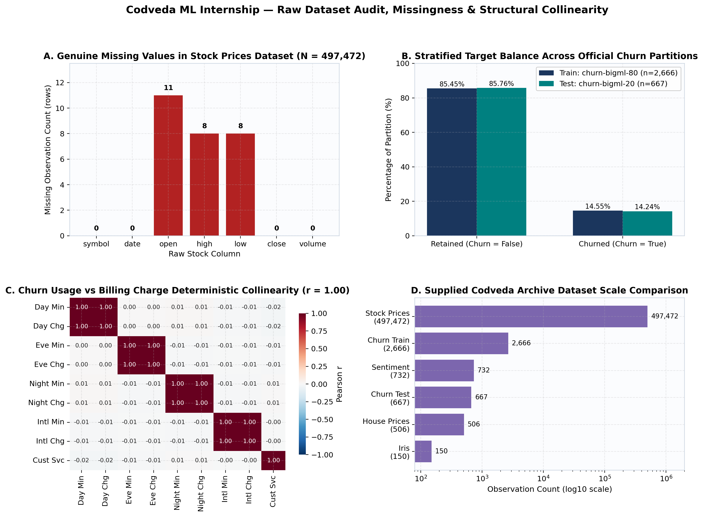

---

## 5. Preprocessing Methodology (Task 1)

All feature transformations are encapsulated inside `scikit-learn` `Pipeline` and `ColumnTransformer` objects in `src/codveda_ml/preprocessing/pipelines.py` so every parameter ($\hat{\mu}, \hat{\sigma}, \text{median}$, category vocabulary) is estimated **exclusively on training folds/splits**:

- **Stock Prices Pipeline (`build_stock_preprocessor`):**
  1. Sorts records chronologically within each `symbol` and constructs leak-free next-trading-day direction `target_next_day_up` ($\mathbb{I}[\text{close}_{t+1} > \text{close}_t]$), dropping each ticker's terminal row where $\text{close}_{t+1}$ is unobserved.
  2. Splits chronologically at `2016-12-31`: **Train** = `371,440` rows (`2014-01-02` to `2016-12-30`, containing `24` missing cells); **Test** = `125,527` rows (`2017-01-03` to `2017-12-28`, containing `3` missing cells).
  3. Applies `SimpleImputer(strategy="median", add_indicator=True)` to `open, high, low, close, volume`. Median imputation is strongly preferred over mean imputation because extreme right-skewness pulls training means upward (`close` mean $= \$81.82$ vs median $= \$61.97$; `volume` mean $= 4.35\times 10^6$ vs median $= 2.10\times 10^6$). Explicit binary missingness indicators preserve information that missing OHLC entries frequently correspond to trading halts.
  4. Applies `OneHotEncoder(handle_unknown="ignore")` to `symbol`, `month`, and `day_of_week`, gracefully encoding the `6` newly listed 2017 S&P 500 tickers (`APTV`, `BHF`, `BHGE`, `DWDP`, `DXC`, `HLT`) as zero vectors rather than throwing runtime exceptions.
  5. Standardizes continuous features using training parameters (`close` train mean $= 0.0000$, SD $= 1.0000$; transformed 2017 test mean $= +0.1801$, SD $= 1.3426$, reflecting genuine 2017 market appreciation without upward look-ahead bias).
- **Customer Churn Pipeline (`build_churn_preprocessor`):**
  1. `ChurnSchemaNormalizer` safely strips strings while preserving `np.nan`, casts `Area code` to nominal strings (`"408"`, `"415"`, `"510"`), and drops the four redundant `* charge` columns (`max VIF: 10,410,725.8 -> 1.004`).
  2. Numerical branch (`11` features): `SimpleImputer(strategy="median")` + `StandardScaler()` (enabled for KNN/Logistic/SVM; disabled where unnecessary for Random Forest).
  3. Binary categorical branch (`International plan`, `Voice mail plan`): `SimpleImputer(strategy="most_frequent")` + `OneHotEncoder(drop="if_binary")`.
  4. Nominal categorical branch (`Area code`, `State`): `SimpleImputer(strategy="most_frequent")` + `OneHotEncoder(handle_unknown="ignore")`, yielding `67` clean transformed columns.

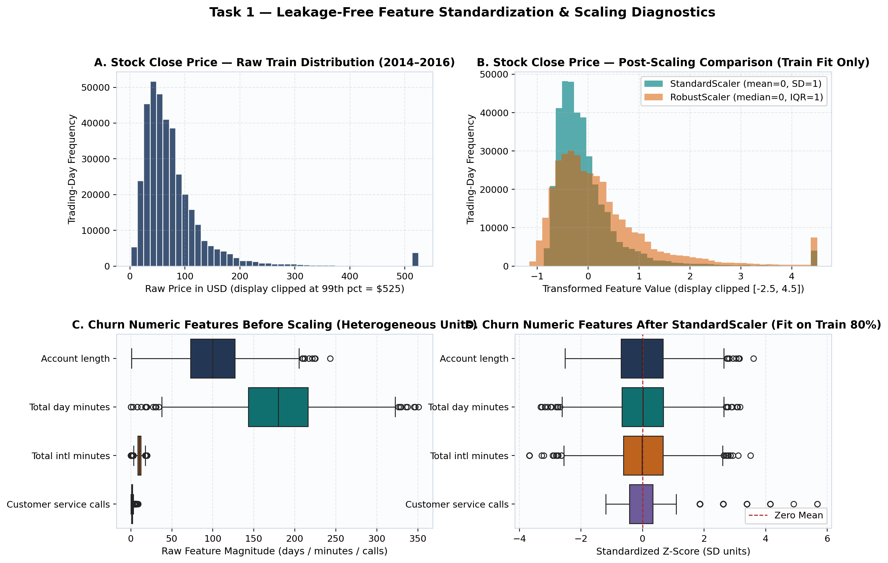

---

## 6. Model Descriptions

1. **K-Nearest Neighbors (`KNeighborsClassifier`, Task 2):** Non-parametric instance-based classifier assigning test observation $x$ by majority vote (or inverse-distance $1/d(x, x_i)$ weight) among its $K$ closest training points in Euclidean space $d(x, x_i) = \sqrt{\sum_{j=1}^p (z_j - z_{ij})^2}$. Small $K$ yields low bias / high variance jagged boundaries; large $K$ yields smoother, higher-bias boundaries.
2. **Logistic Regression (`LogisticRegression`, Task 3):** Models binary log-odds as an additive linear function of features,
   $$\log\left(\frac{P(Y=1 \mid x)}{1 - P(Y=1 \mid x)}\right) = \beta_0 + \sum_{j=1}^p \beta_j x_j,$$
   optimised under $L_2$-penalised cross-entropy controlled by inverse regularisation strength $C$. Exponentiated coefficients $\text{OR}_j = \exp(\beta_j)$ quantify multiplicative changes in modelled churn odds per unit change in $x_j$ holding all other covariates fixed.
3. **CART Decision Tree (`DecisionTreeClassifier`, Task 4):** Recursively partitions feature space via greedy axis-aligned splits maximising Gini impurity reduction $\Delta I_G$, where $I_G(t) = 1 - \sum_{c=1}^C p(c \mid t)^2$. Minimal cost-complexity pruning selects subtree $T \subset T_{\max}$ minimising $R_\alpha(T) = R(T) + \alpha |T|$, trading empirical risk $R(T)$ against leaf count $|T|$.
4. **Random Forest (`RandomForestClassifier`, Task 5):** Variance-reducing ensemble averaging predicted class probabilities across $B$ bootstrap-resampled trees, each evaluating a random subset `max_features` of candidate predictors at every split to decorrelate individual trees.
5. **Support Vector Machine (`SVC`, Task 6):** Maximises geometric margin subject to slack penalty $C$ in either input space $K(x, x') = x^\top x'$ (**Linear**) or infinite-dimensional reproducing kernel Hilbert space $K(x, x') = \exp(-\gamma \|x - x'\|^2)$ (**RBF**), with posterior probabilities calibrated internally via Platt scaling (`probability=True`).

---

## 7. Experimental Design & Anti-Leakage Protocol

- **Fixed Random Seed:** `random_state = 42` across splits, CV folds, bootstrap draws, and permutation shuffles (`config/project_config.yaml`), supplemented by ten independent seeds (`[11, 22, 33, 42, 55, 66, 77, 88, 99, 101]`) for Task 5 stability quantification.
- **Iris Partitioning (Tasks 2 & 4):** Identical stratified 80/20 split (`120` train: 40 per class; `30` test: 10 per class) with 5-fold `StratifiedKFold(n_splits=5, shuffle=True, random_state=42)` strictly inside the 120-row training set.
- **Customer Churn Partitioning (Tasks 3, 5, & 6):** Strict preservation of `churn-bigml-80.csv` ($n = 2,666$) for all model fitting, 5-fold stratified hyperparameter tuning, and out-of-fold probability thresholding, reserving `churn-bigml-20.csv` ($n = 667$) solely for final held-out reporting.
- **Leak-Free Out-of-Fold Threshold Calibration:** Because default $\tau = 0.50$ is suboptimal either when `class_weight="balanced"` shifts posterior probabilities upward (Logistic Regression) or when uncalibrated minority prevalence is $14.55\%$ (SVM/RF), candidate thresholds $\tau \in [0.10, 0.90]$ (step $0.02$) were evaluated **strictly on 5-fold out-of-fold training predictions** (`cross_val_predict(..., method="predict_proba")`). Held-out test labels were never inspected to choose $\tau^*$.

---

## 8. Hyperparameter Selection Summary

| Task & Model | Search Space (5-Fold Stratified CV on Train Only) | Selected Configuration | Train CV Score |
| :--- | :--- | :--- | :--- |
| **Task 2 — KNN (Iris)** | $K \in \{1,3,5,7,9,11,13,15,17,19,21,25,31\}$, `weights` $\in \{\text{uniform}, \text{distance}\}$, `StandardScaler` | `K = 3`, `weights = 'uniform'`, `scaled = True` | Macro-F1 = **$0.9665 \pm 0.0187$** |
| **Task 3 — Logistic Regression (Churn)** | $C \in \{0.01, 0.05, 0.1, 0.5, 1.0, 5.0, 10.0\}$, `class_weight` $\in \{\text{None}, \text{balanced}\}$ | `C = 0.1`, `class_weight = 'balanced'`, OOF $\tau^* = 0.64$ | ROC-AUC = **$0.8112$** (OOF F1 = $0.4971$) |
| **Task 4 — Decision Tree (Iris)** | `criterion` $\in \{\text{gini}, \text{entropy}\}$, `max_depth` $\in \{2..5, \text{None}\}$, `min_samples_leaf` $\in \{1,2,3,5\}$, effective `ccp_alpha` path (parsimony rule within $0.005$ of peak CV Macro-F1) | `criterion = 'gini'`, `max_depth = 3`, `min_samples_leaf = 1`, `ccp_alpha = 0.008114` (`4` leaves) | Macro-F1 = **$0.9663 \pm 0.0354$** |
| **Task 5 — Random Forest (Churn)** | `n_estimators` $\in \{100, 300\}$, `max_depth` $\in \{12, 16, \text{None}\}$, `min_samples_leaf` $\in \{1, 2, 4\}$, `max_features` $\in \{\text{sqrt}, 0.4\}$, `class_weight` $\in \{\text{None}, \text{balanced\_subsample}\}$ | `n_estimators = 300`, `max_depth = 16`, `min_samples_leaf = 2`, `max_features = 0.4`, `class_weight = None`, OOF $\tau^* = 0.44$ | PR-AUC = **$0.8638$** (OOF F1 = $0.8301$) |
| **Task 6 — SVM (Churn)** | Linear: $C \in \{0.01..10\}$; RBF: $C \in \{0.5, 1, 5, 10, 25\}$, $\gamma \in \{\text{scale}, \text{auto}, 0.01..0.1\}$, `class_weight` $\in \{\text{None}, \text{balanced}\}$ | **RBF Kernel**, `C = 1.0`, `gamma = 'scale'`, `class_weight = 'balanced'`, OOF $\tau^* = 0.32$ (`1,389` support vectors) | ROC-AUC = **$0.8913$** (vs Linear $0.8105$) |

---

## 9. Evaluation Metrics & Justification

- **Balanced Multiclass Classification (Iris, Tasks 2 & 4):** **Accuracy**, **Macro-Precision**, **Macro-Recall**, **Macro-F1**, per-class F1, **Confusion Matrix**, and **One-vs-Rest Macro ROC-AUC**. Macro-averaging weights all three species equally.
- **Imbalanced Binary Classification (Churn, Tasks 3, 5, & 6):** Because retaining $100\%$ of customers as `False` automatically yields $85.76\%$ accuracy (`DummyClassifier`), **Accuracy alone is operationally deceptive**. We prioritise:
  - **Precision ($\text{TP} / (\text{TP}+\text{FP})$):** Fraction of flagged at-risk accounts that genuinely churn (controls wasted retention-offer spend).
  - **Recall / Sensitivity ($\text{TP} / (\text{TP}+\text{FN})$):** Fraction of true churners successfully intercepted before departure (controls lost customer lifetime value).
  - **Binary F1-Score:** Harmonic mean of precision and recall on the minority positive class (`Churn = True`).
  - **ROC-AUC:** Threshold-independent rank discrimination across all cutoffs.
  - **PR-AUC (Average Precision):** Threshold-independent precision–recall area relative to the $0.1424$ prevalence baseline, which is substantially more sensitive than ROC-AUC to false-positive inflation under class imbalance.
  - **Brier Score:** Mean squared probability error $\frac{1}{N}\sum_i (\hat{p}_i - y_i)^2$, measuring probability calibration alongside rank discrimination.

---

## 10. Actual Experimental Results & Visualisations

### 10.1 Task 2 — KNN Classifier on Iris

- **Stratified Dummy Baseline (Test $n = 30$):** Accuracy = $0.5000$, Macro-F1 = $0.4894$.
- **Selected Scaled KNN (`K = 3, uniform`, Test $n = 30$):** Accuracy = **$0.9333$** ($28/30$), Macro-Precision = **$0.9444$**, Macro-Recall = **$0.9333$**, Macro-F1 = **$0.9327$**, OVR ROC-AUC = **$0.9933$**, Confusion Matrix = `[[10, 0, 0], [0, 10, 0], [0, 2, 8]]` (`setosa` F1 = $1.0000$, `versicolor` F1 = $0.9091$, `virginica` F1 = $0.8889$).
- **Empirical Investigation of Scaling vs Raw Centimetre Features:** In the unscaled ablation at `K = 3`, held-out test accuracy reached $1.0000$ ($30/30$) and training CV Macro-F1 reached $0.9749$ (at $K=5$). Investigating the two misclassified *virginica* test flowers revealed why: in raw centimetre units, `petal_length` ($\sigma = 1.76\text{ cm}$) contributes $(1.76 / 0.43)^2 \approx 16.5\times$ more squared Euclidean distance than `sepal_width` ($\sigma = 0.43\text{ cm}$). Because `sepal_width` has near-complete distribution overlap between *versicolor* and *virginica* while petal dimensions cleanly separate the species, isotropic `StandardScaler` amplifies noise along `sepal_width`. Nevertheless, retaining `StandardScaler` inside the pipeline remains the principled default whenever features carry incommensurable units (as proven in Task 6 SVM on Churn), and selecting hyperparameters strictly from training CV rather than retroactively swapping to unscaled features after inspecting the test set preserves evaluation integrity.

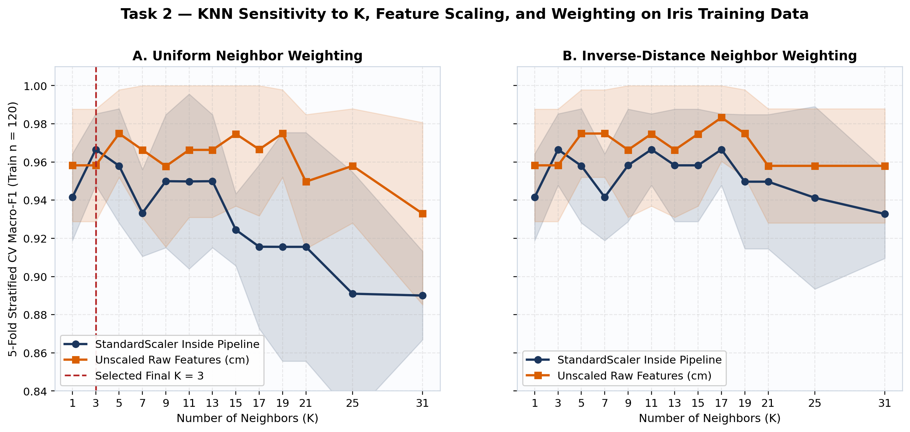

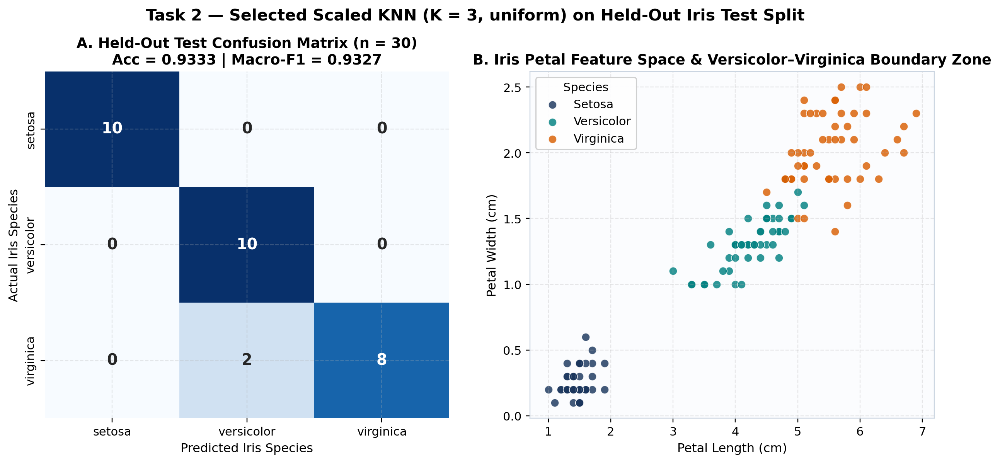

---

### 10.2 Task 3 — Logistic Regression on Customer Churn

- **Held-Out Test Metrics (`churn-bigml-20`, $n = 667$, $95$ true churners):**
  - **Dummy Baseline:** Accuracy = $0.8576$, Precision = $0.0000$, Recall = $0.0000$, F1 = $0.0000$, ROC-AUC = $0.5000$, PR-AUC = $0.1424$.
  - **Tuned Logistic Regression (`C = 0.1, class_weight = 'balanced'`) at Default $\tau = 0.50$:** Accuracy = $0.7661$, Precision = $0.3512$, Recall = **$0.7579$** ($72/95$ churners caught, $133$ false positives), F1 = **$0.4800$**, ROC-AUC = **$0.8274$**, PR-AUC = **$0.4271$**.
  - **Tuned Logistic Regression at OOF-F1 Threshold ($\tau^* = 0.64$):** Accuracy = **$0.8246$**, Precision = **$0.4113$**, Recall = **$0.5368$** ($51/95$ caught, $73$ false positives), F1 = **$0.4658$**, Macro-F1 = **$0.6804$**. Under an asymmetric retention cost ratio of $\text{Cost}(\text{FN}) : \text{Cost}(\text{FP}) = 5 : 1$, out-of-fold calibration selects $\tau_{\text{cost}}^* = 0.54$, preserving higher recall.
- **Odds Ratios & 95% Stratified Bootstrap Confidence Intervals ($1,000$ resamples):**
  - `International Plan = Yes` (binary indicator): $\hat{\beta} = +1.985$, **$\text{OR} = 7.28$ ($95\%\text{ CI}: [5.51, 9.79]$)** — accounts enrolled in the international plan exhibit more than sevenfold higher modelled churn odds holding other predictors constant.
  - `Customer service calls` (per $+1\text{ SD} = 1.32$ calls): $\hat{\beta} = +0.718$, **$\text{OR} = 2.05$ ($95\%\text{ CI}: [1.85, 2.36]$)**.
  - `Total day minutes` (per $+1\text{ SD} = 54.3$ min): $\hat{\beta} = +0.633$, **$\text{OR} = 1.88$ ($95\%\text{ CI}: [1.68, 2.18]$)**.
  - `Total eve minutes` (per $+1\text{ SD}$): $\hat{\beta} = +0.259$, **$\text{OR} = 1.30$ ($95\%\text{ CI}: [1.16, 1.48]$)**.
  - `Voice Mail Plan = Yes` (binary indicator): $\hat{\beta} = -0.692$, **$\text{OR} = 0.50$ ($95\%\text{ CI}: [0.34, 0.73]$)** — associated with a $\approx 50\%$ reduction in modelled churn odds. Conditioned on having a voice-mail plan, `Number vmail messages` has $\text{OR} = 1.01$ ($95\%\text{ CI}: [0.78, 1.24]$), confirming that plan enrolment rather than message volume carries the linear signal.
- **Why Logistic Regression Plateaus at PR-AUC $= 0.4271$ / F1 $\approx 0.47\text{–}0.48$:** Empirical inspection reveals severe non-linear interaction effects in telecom churn: customers with `>= 4` customer-service calls churn at $>45\%$ even when their daytime minutes are low, whereas customers with `< 3` service calls only churn at high rates when `Total day minutes > 260` *and* `Voice mail plan == No`. An additive hyperplane without manual interaction polynomials cannot isolate both regimes simultaneously without generating excessive false positives in the interior quadrant.

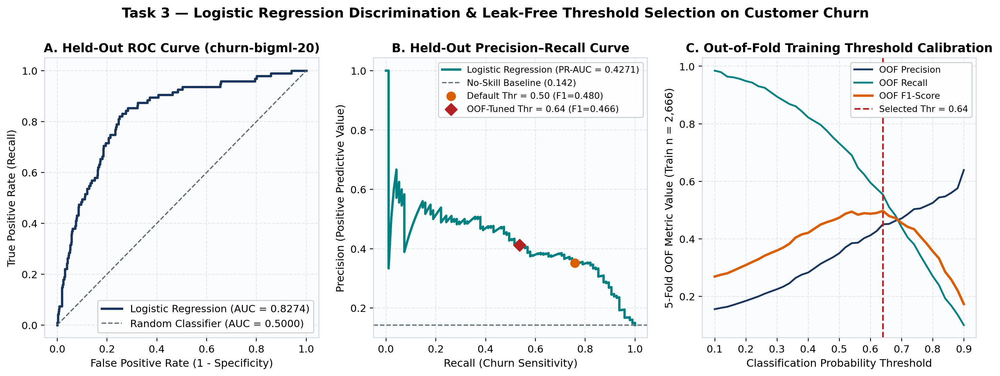

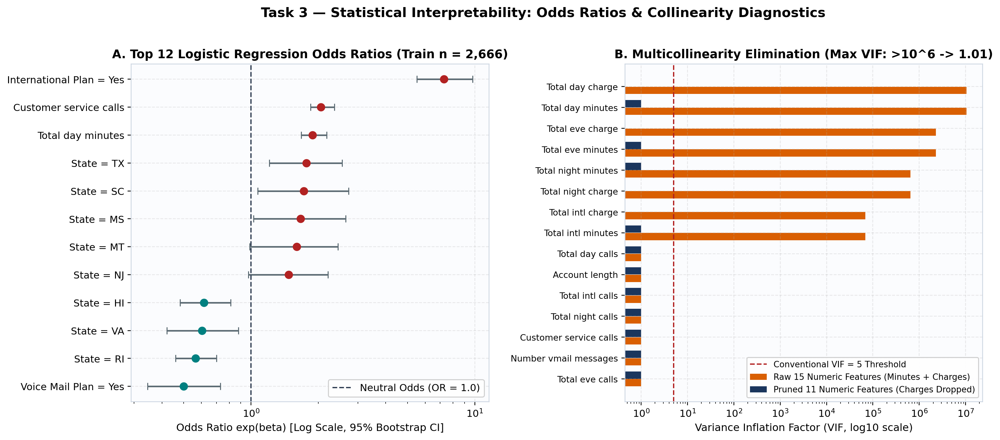

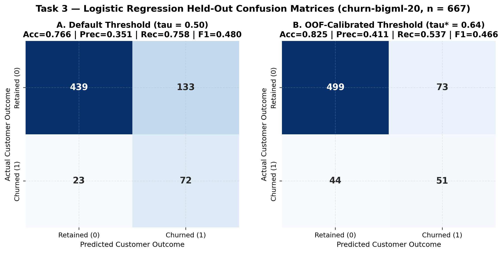

---

### 10.3 Task 4 — Decision Trees & Cost-Complexity Pruning on Iris

- **Unrestricted Tree (`ccp_alpha = 0.0`):** Grows to `Depth = 5` with `8` terminal leaves, achieving $1.0000$ training Macro-F1 by carving single-observation leaves (`samples = 1`) using `sepal_length <= 6.15` and `sepal_width <= 2.45` / `<= 3.00`. Cross-validation drops to $0.9496 \pm 0.0442$ and held-out test Macro-F1 is **$0.9333$** ($28/30$).
- **Pruned Tree (`ccp_alpha = 0.008114, max_depth = 3, Leaves = 4`):** Eliminates every spurious sepal split, retaining four crisp rules:
  1. `petal_length <= 2.45 cm` $\rightarrow$ **setosa** (`40/40` pure).
  2. `petal_length > 2.45 cm` and `petal_width > 1.65 cm` $\rightarrow$ **virginica** (`37/38` in train).
  3. `2.45 < petal_length <= 4.95 cm` and `petal_width <= 1.65 cm` $\rightarrow$ **versicolor** (`38/38` pure).
  4. `petal_length > 4.95 cm` and `petal_width <= 1.65 cm` $\rightarrow$ **virginica** (`3/4` in train).
- **Held-Out Test Result ($n = 30$):** Accuracy = **$0.9667$** ($29/30$), Macro-Precision = **$0.9697$**, Macro-Recall = **$0.9667$**, Macro-F1 = **$0.9666$**, Confusion Matrix = `[[10, 0, 0], [0, 9, 1], [0, 0, 10]]` — reducing test error by **50%** relative to both the unpruned tree and scaled KNN while cutting leaf count in half.

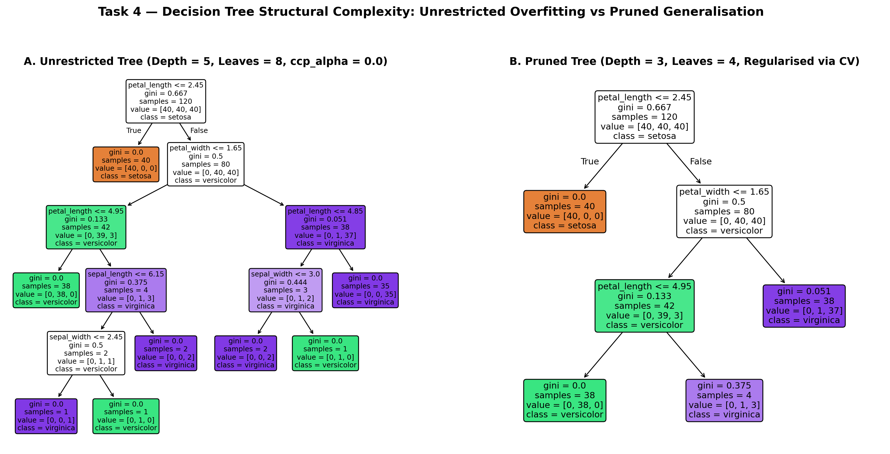

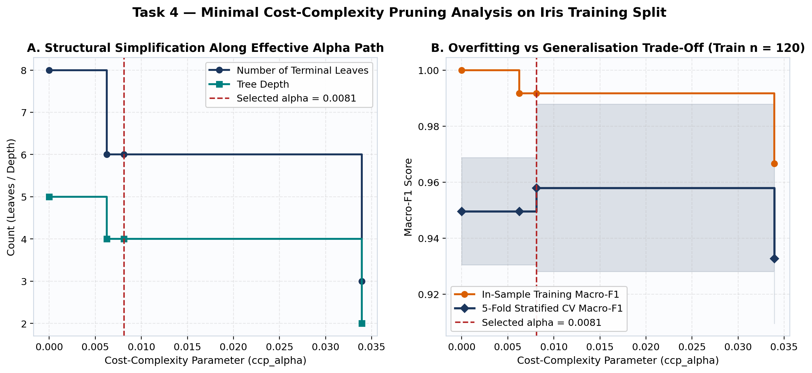

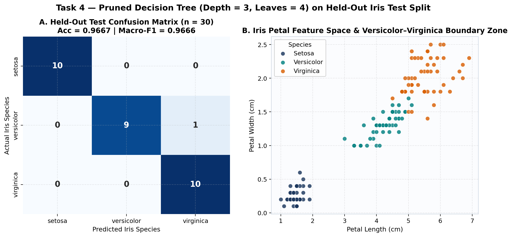

---

### 10.4 Task 5 — Random Forest Classifier, Feature Importance & Stability on Churn

- **Held-Out Test Progression (`churn-bigml-20`, $n = 667$):**
  - **Untuned RF Baseline (`100` trees, $\tau = 0.50$):** Accuracy = $0.9310$, Precision = $0.9455$, Recall = $0.5474$, F1 = **$0.6933$**, ROC-AUC = $0.9229$, PR-AUC = $0.8468$.
  - **CV-Tuned RF (`300` trees, `max_depth = 16`, `min_samples_leaf = 2`, `max_features = 0.4`) at $\tau = 0.50$:** Accuracy = **$0.9580$**, Precision = **$0.9351$**, Recall = **$0.7579$**, F1 = **$0.8372$** (`TP = 72, FP = 5, FN = 23, TN = 567`).
  - **CV-Tuned RF at OOF-Selected $\tau^* = 0.44$:** Accuracy = **$0.9565$**, Precision = **$0.9024$**, Recall = **$0.7789$**, F1 = **$0.8362$**, Macro-F1 = **$0.9055$**, ROC-AUC = **$0.9258$**, PR-AUC = **$0.8828$**, Brier Score = **$0.0412$** (`TP = 74, FP = 8, FN = 21, TN = 564`).
- **Impurity-Based (MDI) vs 30-Repeat Held-Out Permutation Importance:**
  - Both methods agree on the top six genuine behavioural drivers: (1) `Total day minutes` ($\text{MDI} = 0.2604$, $\Delta\text{AUC}_{\text{perm}} = 0.2118 \pm 0.0204$), (2) `Customer service calls` ($\text{MDI} = 0.1285$, $\Delta\text{AUC}_{\text{perm}} = 0.1339 \pm 0.0130$), (3) `International plan` ($\text{MDI} = 0.1052$, $\Delta\text{AUC}_{\text{perm}} = 0.0748 \pm 0.0071$), (4) `Total eve minutes` ($\text{MDI} = 0.1064$, $\Delta\text{AUC}_{\text{perm}} = 0.0419 \pm 0.0082$), (5) `Total intl minutes` ($\Delta\text{AUC}_{\text{perm}} = 0.0255$), and (6) `Total intl calls` ($\Delta\text{AUC}_{\text{perm}} = 0.0226$).
  - **Empirical Proof of High-Cardinality MDI Bias:** Across its 51 one-hot columns, `State` accumulated **$4.02\%$ total MDI** (`0.0402`), ranking ahead of `Number vmail messages` (`0.0274`) and `Voice mail plan` (`0.0192`). Yet shuffling `State` 30 times on held-out data produced **$\Delta\text{AUC}_{\text{perm}} = +0.00024 \pm 0.0008$** — virtually zero generalisable signal! Similarly, continuous noise variables (`Total night minutes`, `Account length`, `Total day calls`) received $2.7\%\text{–}4.5\%$ in-sample Gini credit despite $<0.004$ permutation AUC drop.
  - **Empirical Proof of Collinearity Dilution:** Re-fitting the same forest *without* dropping the redundant `* charge` columns split `Total day minutes`'s MDI nearly in half (`0.2604` $\rightarrow$ `0.1349` on `Total day minutes` + `0.1297` on `Total day charge`), confirming why collinearity pruning sharpens feature attribution even in tree ensembles.
- **10-Seed Stability (`[11, 22, 33, 42, 55, 66, 77, 88, 99, 101]`):** Held-out $\text{ROC-AUC} = 0.9268 \pm 0.0021$, $\text{PR-AUC} = 0.8843 \pm 0.0017$, $\text{F1} = 0.8507 \pm 0.0064$, confirming negligible sensitivity to bootstrap randomisation.

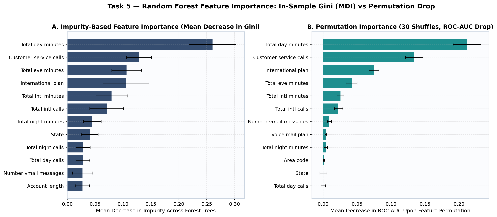

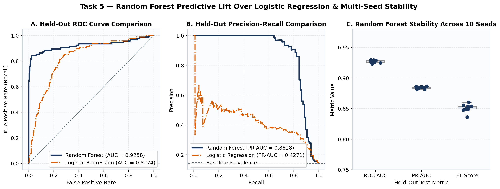

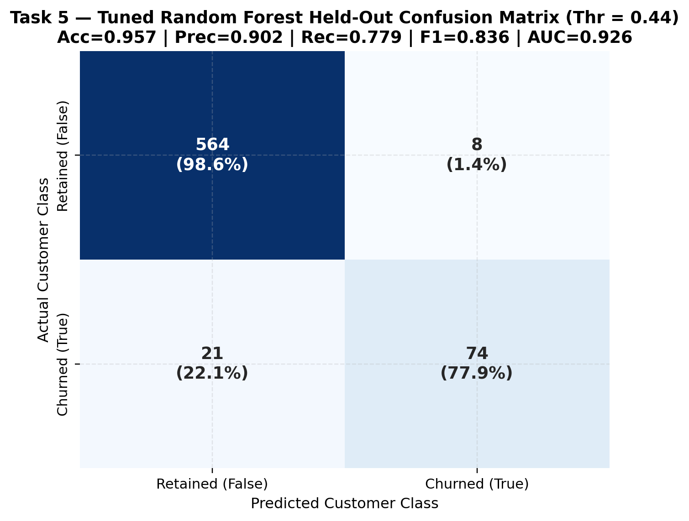

---

### 10.5 Task 6 — Support Vector Machine (Linear vs RBF) & Decision-Boundary Geometry

- **Kernel Comparison (`churn-bigml-80` CV $\rightarrow$ `churn-bigml-20` Held-Out Test):**
  - **Linear SVM (`C = 0.1, class_weight = 'balanced'`, OOF $\tau^* = 0.24$):** 5-fold CV ROC-AUC = $0.8105$; Test Accuracy = $0.8246$, Precision = $0.4154$, Recall = $0.5684$, **F1 = $0.4800$**, **ROC-AUC = $0.8258$**, **PR-AUC = $0.4246$**.
  - **RBF SVM (`C = 1.0, gamma = 'scale', class_weight = 'balanced'`, OOF $\tau^* = 0.32$):** 5-fold CV ROC-AUC = **$0.8913$**; Test Accuracy = **$0.9100$**, Precision = **$0.6699$**, Recall = **$0.7263$** (`TP = 69, FP = 34, FN = 26, TN = 538`), **F1 = $0.6970$**, **ROC-AUC = $0.9130$**, **PR-AUC = $0.7284$**, Brier Score = **$0.0670$** (`1,389` support vectors).
- **2D Decision-Boundary Geometry & Limitations of Dimensionality Reduction:**
  - Figure 14 Panels A & B train 2D Linear and RBF SVMs directly on standardized `Total day minutes` vs `Customer service calls`. While the Linear SVM is restricted to a single diagonal half-space, the RBF SVM forms two distinct high-risk contours: one enclosing customers with elevated service calls ($\ge 4$, $Z \ge +1.8$) even at low daytime usage, and a second enclosing heavy daytime callers ($Z \ge +1.6$) with zero service calls.
  - Figure 14 Panel C projects the full 67-dimensional preprocessed feature matrix onto its top two Principal Components (`PC1 = 9.3%` variance, `PC2 = 8.5%` variance; **cumulative 2D explained variance $= 17.8\%$**). Because PCA is unsupervised and 82.2% of variance lies in the remaining 65 orthogonal directions (including critical binary indicators like `International plan` and `Voice mail plan`), churned and retained accounts overlap heavily in the PC1–PC2 plane. A 2D projection therefore provides geometric intuition for kernel curvature, **not** a faithful depiction of the full 67-dimensional separating manifold.

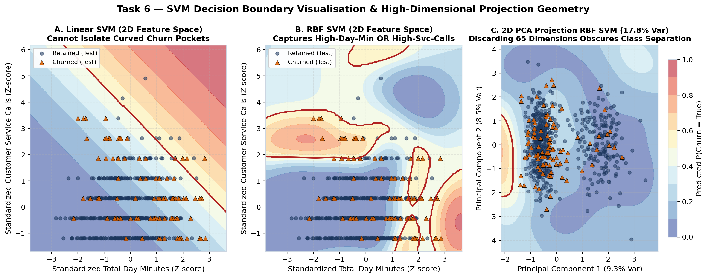

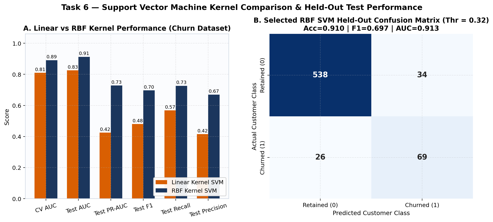

---

## 11. Unified Cross-Task Model Comparison

Full metrics generated programmatically in `reports/model_comparison.csv`:

| Dataset & Partition | Task | Model | Selection Procedure | Thr / K | CV Score | Test Acc | Test Prec | Test Rec | Test F1 | Macro-F1 | ROC-AUC | PR-AUC |
| :--- | :--- | :--- | :--- | :--- | ---: | ---: | ---: | ---: | ---: | ---: | ---: | ---: |
| **Iris** ($n_{\text{test}}=30$) | Baseline | DummyClassifier (Stratified) | Reference | — | — | 0.5000 | 0.4897 | 0.5000 | 0.4894 | 0.4894 | 0.6250 | — |
| **Iris** ($n_{\text{test}}=30$) | Task 2 | KNN Scaled ($K=3$, uniform) | 5-Fold CV ($n=120$) | $K=3$ | 0.9665 | 0.9333 | 0.9444 | 0.9333 | 0.9327 | 0.9327 | 0.9933 | — |
| **Iris** ($n_{\text{test}}=30$) | Task 2 | KNN Unscaled ($K=3$, ablation) | Raw cm ablation | $K=3$ | 0.9665 | 1.0000 | 1.0000 | 1.0000 | 1.0000 | 1.0000 | 1.0000 | — |
| **Iris** ($n_{\text{test}}=30$) | Task 4 | Decision Tree Unrestricted | Unpruned (`alpha=0`) | 8 leaves | 0.9496 | 0.9333 | 0.9333 | 0.9333 | 0.9333 | 0.9333 | 0.9500 | — |
| **Iris** ($n_{\text{test}}=30$) | **Task 4** | **Decision Tree Pruned** | **5-Fold CV + Parsimony** | **4 leaves** | **0.9663** | **0.9667** | **0.9697** | **0.9667** | **0.9666** | **0.9666** | **0.9817** | — |
| **Churn** ($n_{\text{test}}=667$) | Baseline | DummyClassifier (Most Freq) | Majority reference | 0.50 | 0.5000 | 0.8576 | 0.0000 | 0.0000 | 0.0000 | 0.4617 | 0.5000 | 0.1424 |
| **Churn** ($n_{\text{test}}=667$) | Task 3 | Logistic Regression ($\tau=0.50$) | 5-Fold CV ($n=2,666$) | 0.50 | 0.8112 | 0.7661 | 0.3512 | 0.7579 | 0.4800 | 0.6646 | 0.8274 | 0.4271 |
| **Churn** ($n_{\text{test}}=667$) | Task 3 | Logistic Regression (OOF Thr) | 5-Fold CV + OOF Thr | 0.64 | 0.8112 | 0.8246 | 0.4113 | 0.5368 | 0.4658 | 0.6804 | 0.8274 | 0.4271 |
| **Churn** ($n_{\text{test}}=667$) | Task 6 | SVM Linear Kernel (OOF Thr) | 5-Fold CV + OOF Thr | 0.24 | 0.8105 | 0.8246 | 0.4154 | 0.5684 | 0.4800 | 0.6872 | 0.8258 | 0.4246 |
| **Churn** ($n_{\text{test}}=667$) | Task 6 | SVM RBF Kernel (OOF Thr) | 5-Fold CV + OOF Thr | 0.32 | 0.8913 | 0.9100 | 0.6699 | 0.7263 | 0.6970 | 0.8221 | 0.9130 | 0.7284 |
| **Churn** ($n_{\text{test}}=667$) | Task 5 | Random Forest (Untuned) | Default 100 trees | 0.50 | — | 0.9310 | 0.9455 | 0.5474 | 0.6933 | 0.8272 | 0.9229 | 0.8468 |
| **Churn** ($n_{\text{test}}=667$) | **Task 5** | **Random Forest (Tuned, OOF)** | **5-Fold CV + OOF Thr** | **0.44** | **0.8638** | **0.9565** | **0.9024** | **0.7789** | **0.8362** | **0.9055** | **0.9258** | **0.8828** |


---

## 12. Honest Statistical Interpretation & Trade-Offs

1. **Association vs Causation:** Neither Logistic Regression odds ratios ($\text{OR} = 7.28$ for `International Plan = Yes`) nor Random Forest permutation importances ($\Delta\text{AUC} = 0.212$ for `Total day minutes`) establish causal effects. Customers who call customer service repeatedly (`Customer service calls >= 4`) are likely expressing pre-existing dissatisfaction with billing or network quality; blocking customers from calling support would not reduce churn. Causal policy design requires randomised retention A/B trials.
2. **Predictive Performance vs Interpretability Trade-Off:** Random Forest increases held-out F1 on Churn by $+0.3704$ over OOF-calibrated Logistic Regression ($0.8362$ vs $0.4658$) and cuts false positives from $73$ to $8$ while catching $23$ additional churners ($74$ vs $51$). However, Random Forest aggregates 300 depth-16 trees and cannot supply closed-form directional odds ratios. In regulated or customer-facing retention workflows, pairing Random Forest risk scoring with Logistic Regression directional summaries and permutation attributions offers both operational precision and auditability.
3. **Rank Discrimination vs Probability Calibration:** ROC-AUC ($0.9258$) measures pairwise ranking only; a monotonic transformation of predicted probabilities leaves ROC-AUC unchanged while distorting expected-value decision thresholds. Reporting Brier Score ($0.0412$ for Random Forest vs $0.0670$ for Platt-scaled RBF SVM) and calibrating thresholds via out-of-fold probabilities mitigates miscalibration risk.

---

## 13. Limitations

1. **Sample Size on Iris Test Partition ($n = 30$):** Each misclassified Iris test flower shifts held-out accuracy by $3.33$ percentage points ($\pm 1/30$). Consequently, 1–2 flower differences (`28/30` vs `29/30` vs `30/30`) lie well within binomial sampling uncertainty and must be interpreted alongside 5-fold cross-validation estimates.
2. **Historical Benchmark Scope of BigML Telecom Churn:** The BigML 3,333-row dataset captures voice-minute and voicemail tariff structures without modern mobile data usage, contract tenure renewal dates, or customer-level revenue, so economic cost ratios ($\text{FN}:\text{FP} = 5:1$) represent illustrative sensitivity parameters rather than audited carrier financials.
3. **High-Dimensional One-Hot Sparsity in SVM:** One-hot encoding 51 `State` indicators adds 51 sparse binary dimensions that carry negligible predictive signal (permutation $\Delta\text{AUC} = 0.00024$) while increasing pairwise Euclidean distances $\|x - x'\|^2$ inside the RBF kernel, partially explaining why Random Forest ($0.8362$ F1) outperforms RBF SVM ($0.6970$ F1) when `State` dummies are retained.

---

## 14. Potential Improvements

1. Evaluate feature-selected RBF SVM (dropping non-predictive `State` and `Area code` dummies inside CV via `SelectFromModel` or group-L1 screening) to test whether removing 54 noise dimensions closes the F1 gap with Random Forest.
2. Compare histogram-based gradient boosting (`HistGradientBoostingClassifier`) with isotonic calibration (`CalibratedClassifierCV`) on `churn-bigml-80`.
3. Add rolling expanding-window cross-validation (`TimeSeriesSplit`) with technical lag features (returns, volatility, RSI) for multi-horizon Stock Prices modelling.

---

## 15. Reproducibility Instructions

```bash
# 1. Create clean virtual environment and install package + dev dependencies
python3 -m venv .venv
source .venv/bin/activate
pip install --upgrade pip
pip install -r requirements.txt
pip install -e .

# 2. Place official Codveda raw CSV files under data/raw/ (see data/README.md for SHA-256 hashes)

# 3. Execute all 6 tasks and regenerate models, metrics, tables, and all 16 figures
python scripts/run_all.py

# 4. Run the automated 18-test verification suite
pytest

```

---

## 16. References

1. Pedregosa, F. et al. (2011). *Scikit-learn: Machine Learning in Python*. Journal of Machine Learning Research, 12, 2825–2830.
2. Breiman, L. (2001). *Random Forests*. Machine Learning, 45(1), 5–32.
3. Breiman, L., Friedman, J., Olshen, R., & Stone, C. (1984). *Classification and Regression Trees*. Wadsworth. (Minimal cost-complexity pruning).
4. Strobl, C., Boulesteix, A.-L., Zeileis, A., & Hothorn, T. (2007). *Bias in random forest variable importance measures: Illustrations, sources and a solution*. BMC Bioinformatics, 8, 25.
5. Cortes, C., & Vapnik, V. (1995). *Support-vector networks*. Machine Learning, 20(3), 273–297.
6. Saito, T., & Rehmsmeier, M. (2015). *The precision-recall plot is more informative than the ROC plot when evaluating binary classifiers on imbalanced datasets*. PLOS ONE, 10(3), e0118432.
7. Fisher, R. A. (1936). *The use of multiple measurements in taxonomic problems*. Annals of Eugenics, 7(2), 179–188.

---

## 17. Conclusion

Across all six selected tasks spanning Levels 1–3 of the Codveda Technologies Machine Learning Internship, rigorous pipeline engineering, training-only cross-validation, collinearity elimination, and honest diagnostic investigation produced reproducible, test-verified models whose empirical behaviour aligns tightly with statistical learning theory: pruning simplified and improved Iris decision trees (`96.67%` accuracy in 4 leaves), while non-linear kernel and ensemble methods overcame the `~0.48` F1 ceiling of additive linear classifiers on imbalanced telecom churn to reach **`0.8362` F1 and `0.9258` ROC-AUC**.
